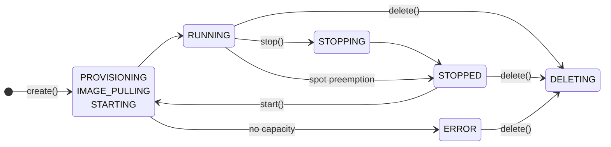

# First endpoint

Serve `Qwen/Qwen3-0.6B` with vLLM on one H100, wait until the model answers, send one chat request, and delete the endpoint.

!!! warning "An endpoint bills while it runs"
    From create until it is stopped or deleted. Closing the process does neither. This script deletes the endpoint in `finally`, also when a step fails or you press ++ctrl+c++.

```python title="examples/inference/vllm-endpoint/serve.py"
--8<-- "examples/inference/vllm-endpoint/serve.py"
```

```bash
uv run python examples/inference/vllm-endpoint/serve.py
```

## What happens

1. `ns.EndpointSpec(...)` builds a local recipe. Token auth is the default.
2. `create()` returns once Nebius has accepted the endpoint. It generates a random bearer token, keeps it in `endpoint.token`, and prints a notice.
3. `wait(probe="/v1/models")` waits for `RUNNING` with a managed `https://` URL, then until `/v1/models` answers. `RUNNING` alone means the tunnel is up, not that vLLM has loaded the model. Pulling the image and loading the model take a few minutes.
4. The script sends one request to `/v1/chat/completions` with `Authorization: Bearer <token>`, prints the reply, and deletes the endpoint.

## Endpoint states



`RUNNING` bills for compute. A `STOPPED` endpoint is not billed for compute or its disk, though mounted volumes still bill, and it keeps its id and URL. An endpoint in `ERROR` is not billed; delete it when you are done.

## Next

[Serve a model with vLLM](../inference/vllm-endpoint.md) covers the YAML recipe, calling the endpoint yourself, reloading it by id, and stop and start.
