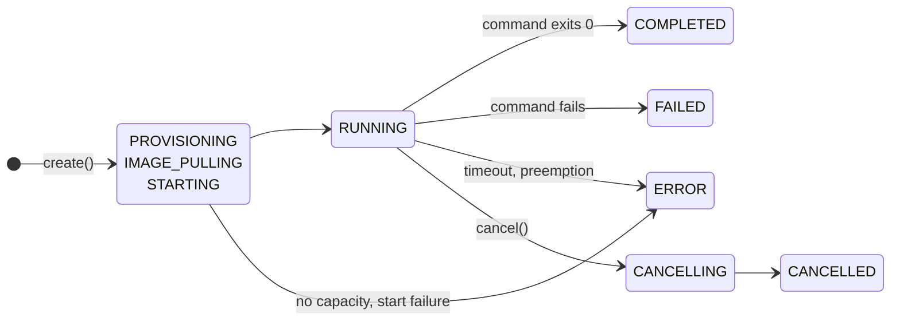

# First job

Run `nvidia-smi` on one on-demand H100, wait for it, and print the record. The same job in three forms:

=== "Python"

    ```python title="examples/quickstarts/job_quickstart.py"
    --8<-- "examples/quickstarts/job_quickstart.py"
    ```

    ```bash
    uv run python examples/quickstarts/job_quickstart.py
    ```

=== "YAML"

    ```yaml title="examples/quickstarts/job_quickstart.yaml"
    --8<-- "examples/quickstarts/job_quickstart.yaml"
    ```

    [`job_from_yaml.py`](https://github.com/mnrozhkov/nebius-serverless/blob/main/examples/quickstarts/job_from_yaml.py) loads it with `ns.JobSpec.from_yaml`, creates the job, waits, and exits non-zero unless it ends `COMPLETED`:

    ```bash
    uv run python examples/quickstarts/job_from_yaml.py \
      --config examples/quickstarts/job_quickstart.yaml
    ```

=== "CLI"

    ```bash title="examples/quickstarts/job_quickstart.sh"
    --8<-- "examples/quickstarts/job_quickstart.sh"
    ```

    `spec.to_cli()` prints this command for any recipe. See [YAML and the CLI](../guides/yaml-cli.md).

`create(dry_run=True)` returns the create request and creates nothing: use it to check a recipe first.

## What happens

1. `ns.JobSpec(...)` builds a local recipe. Nothing contacts Nebius yet.
2. `create()` sends the request and returns once Nebius has accepted the job and its id is known. It prints the id. It does not wait for the container.
3. `wait()` polls about every 10 seconds and prints each new state until a final one.
4. `display()` prints the record: the machine Nebius picked, disk, timings, and the final state.

The output of `nvidia-smi` is in the container logs:

```bash
nebius ai job logs <id>
```

## Job states



`wait()` returns on `COMPLETED`, `FAILED`, `CANCELLED`, `ERROR`, or `DELETING`. A failed job is data, not an exception: check `job.status`, and read the reason in the final progress line or in `display()`. `FAILED` means your command failed, after any `restart_attempts`. `ERROR` means the platform ended the job: no capacity, a startup failure, the `timeout`, or a spot preemption.

## Pick another machine

`gpu="h100"` asks Nebius for one H100; in `eu-north1` it picks `gpu-h100-sxm` and `1gpu-16vcpu-200gb`. Use `gpu="h100:8"` for eight, omit `gpu` for the smallest CPU machine, or pass `cpu="amd:16"`. See [Choose a machine and pricing](../guides/machines.md).

## Next

Serve a model on your [first endpoint](first-endpoint.md), or fine-tune one in [Training](../training/index.md).
