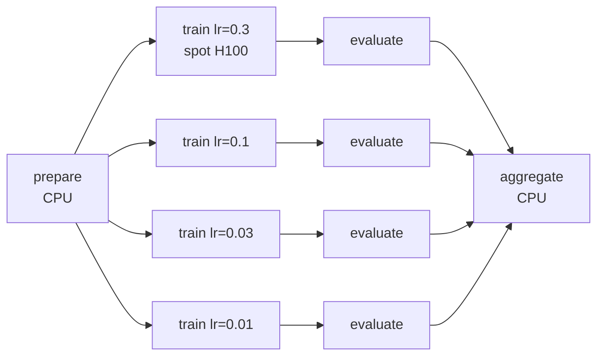

# Pipeline of tasks

Train a small image classifier on MNIST with four learning rates at once, evaluate each result, and pick the best one. Every step is an [`ns.Task`](../reference/tasks.md), and the same pipeline runs as plain Python or as a [Prefect flow](../reference/flows.md).



The code is in [`examples/tasks/`](https://github.com/mnrozhkov/nebius-serverless/tree/main/examples/tasks):

| File | What it holds |
| --- | --- |
| `tasks.py` | The image and the five tasks. |
| `train.py` | The pipeline and the command line. |
| `src/` | An ordinary Python package: data loading, the model, training, evaluation. Tasks send it to their jobs with `include_libs=["src"]`. |

## Run it

From `examples/tasks/`, with [Object Storage credentials](../reference/tasks.md#files-and-the-task-bucket) set:

=== "Plain Python"

    ```bash
    python train.py
    ```

    The script starts every job and waits for the result. No Prefect is needed.

=== "Prefect, flow here"

    ```bash
    export PREFECT_API_URL=https://prefect.example.com/api
    python train.py --mode prefect-local
    ```

    `pipeline` runs as the Prefect flow `mnist-baseline` in this process. Needs `pip install prefect`.

=== "Prefect, flow on a job"

    ```bash
    export PREFECT_API_URL=https://prefect.example.com/api
    python train.py --mode prefect-remote
    ```

    `pipeline` runs as a Prefect flow on a small CPU job. The script ends once the flow job has started, and prints the link to the flow run.

## How it fits together

**One image.** `tasks.py` builds the training image from an inline Dockerfile with `ns.Image(dockerfile_string=...)`. It is built on the first run and reused after that. `aggregate` needs only Python and uses `python:3.12-slim-bookworm`.

**Three kinds of task.**

- `gpu_check` is a bash script. It reads `${inputs[fields]}` and sets `outputs[gpu_name]` and others.
- `prepare` wraps `prepare_data` from the `src` package. The job imports it by name.
- `train` and `evaluate` wrap small functions defined in `tasks.py` that import from `src` inside their bodies. `aggregate` is a self-contained function.

**Runs as arguments.** `train.submit(...)` returns at once, so the four training jobs start together. Each run is passed to `evaluate.submit(trained=run, ...)`, whose job starts as soon as that training run has finished. `aggregate` gets all runs and all scores.

**Files.** A task writes checkpoints to `$NS_OUTPUT_DIR` and returns the path. Every task's job sees the task bucket at the same path, so `evaluate` opens the checkpoint that `train` wrote.

**Prefect.** `ns.PrefectFlow(pipeline, ...)` turns each task call into a Prefect task run with a link to its job. A run's files go to `flows/mnist-baseline/<run>/` in the bucket, one folder per task job.

## Source

??? example "tasks.py"

    ```python
    --8<-- "examples/tasks/tasks.py"
    ```

??? example "train.py"

    ```python
    --8<-- "examples/tasks/train.py"
    ```
